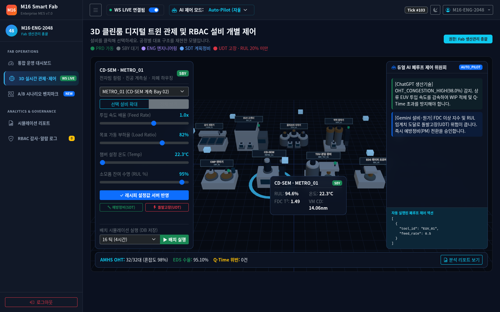
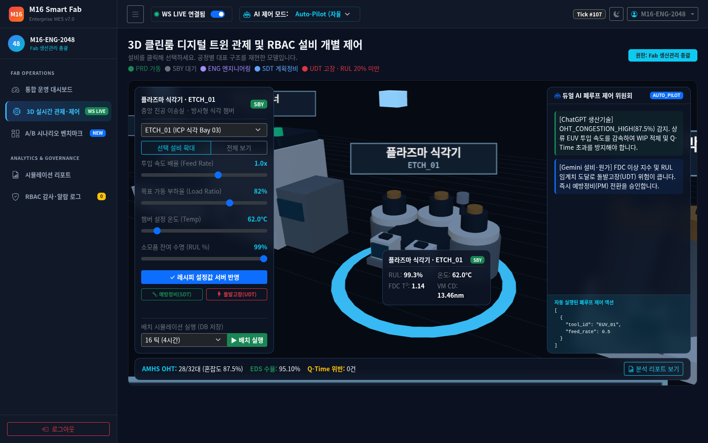

# M16 가상 반도체 팹 디지털 트윈

## 최신 버전 · Enterprise v7

WebSocket 실시간 관제, Auto-Pilot/HITL, A/B 벤치마크, 직무별 감사 기록을
[독립 v7 패키지](m16_enterprise_v7/README.md)에서 실행할 수 있습니다.
저장소 루트의 기존 시뮬레이션과 GitHub Actions도 사용할 수 있습니다.

```bash
cd m16_enterprise_v7
docker compose up --build -d
```

기본 포트는 8000이며, 대시보드는 `/`, Swagger는 `/docs`입니다.


### 3D 관제 미리보기

**전체 관제 화면** · 8종 설비의 형태와 상태등을 한눈에 볼 수 있습니다.



**플라즈마 식각기 확대** · 원통형 식각 챔버와 설비별 상태, 잔여수명, 온도, FDC T², 예측 CD가 표시됩니다.



## 기존 시뮬레이션

첨부 v2의 3D 장면과 WIP·PM·램프업·전력/원가 모델을 반영한 교육용 시뮬레이션입니다. 실제 SK하이닉스 공정 데이터/공식 설비 모델이 아니며, 200매는 가상 입고 배치입니다.

## 실행

```bash
python -m pip install -r requirements.txt
python run_cycle.py --mode mock --force-ai-debate
python -m http.server 8000
```

http://localhost:8000 에서 3D 화면을 엽니다. 3D/차트/CSS 라이브러리는 첨부본의 외부 CDN을 사용합니다. 화면의 로컬 버튼은 미리보기이고 GitHub 데이터에는 반영되지 않습니다. 별도 Python 실행은 `python factory_sim.py` 다음 `python ai_council.py --mode mock` 순서로도 가능합니다.

## v2 반영

- 제어: euv_throughput, chiller_power, auto_foup_order, schedule_pm.
- 상태: 기존 팹 필드에 hbm_wip_buffer, power_kwh, unit_cost_index, ramp_up_remaining 추가.
- 전공정 투입 `floor(throughput*0.6)`, 후공정 최대 48매/사이클. 잔여 물량은 WIP에 보존합니다.
- wafer_output/total_wafer_output은 v2부터 추정 양품 완료량입니다. v1의 총처리량과 의미가 다릅니다. 이번 초기 상태 교체는 사용자 요청대로 cycle=0에서 시작합니다.
- 수명 <20% 또는 PM 예약이면 한 사이클 생산을 쉬고 수명 100%, 이후 두 사이클 60%/80% 램프업을 적용합니다. PM 중 WIP를 임의로 폐기하지 않습니다.
- 온도/EDS/청정도/펠리클/WIP 위험과 3사이클 주기, 최초 가동, force_ai_debate에 따라 3턴을 소집합니다. 정상 대기 사이클은 hold로 기록하고 공급자 API를 호출하지 않습니다. 모든 사이클에서 SOP는 실행됩니다.
- 1턴 OpenAI 생산안, 2턴 Gemini 안전안, 3턴 짝수 OpenAI/홀수 Gemini 의장입니다. 최근 5사이클 텔레메트리를 제공합니다.
- telemetry_history.json은 최근 100개의 센서 스냅샷, logs/cycles는 전체 의사결정 원장입니다. 로그의 mock/hold/live/fallback을 구분합니다.
- API 실패는 fallback으로 기록합니다. 장애 Issue는 기존 봇 소유 Issue를 재사용하고 실제 회의 응답을 댓글에 사용하므로 복구 보고를 위해 API를 추가 호출하지 않습니다.

## 수정한 경계 조건

첨부 코드의 위험 상태 기준(온도 >=68, 수율 <88, 재고 <50, 청정도 >=45)을 공통 함수로 통일했습니다. 68°C부터 전공정을 정지하고 냉각을 유지합니다. 후공정은 쌓인 WIP를 처리할 수 있습니다. PM 후에도 센서가 위험하면 CRITICAL을 유지합니다. 재고가 없어 생산하지 않으면 생산 발열과 생산 마모도 발생하지 않습니다. 청정도 >30, 펠리클 <35, WIP >85는 WARNING입니다. 펠리클 <22이면 PM 예약을 강제합니다.

전력과 원가는 첨부 계수를 사용한 합성 지표입니다. EDS는 정지 중에도 계산하는 품질 추정치로, 실제 표본 수율이나 HBM 패키지 단위 모사는 아닙니다. WIP 손실은 후공정 처리량 중 추정 양품이 아닌 부분으로 해석합니다.

## 동시성

웹 화면은 config.json을 직접 수정하지 않고 `workflow_dispatch`의 config_json과 expected_config_sha로 변경을 요청합니다. 같은 concurrency 그룹에서 설정 적용과 시뮬레이션을 처리하며, 최신 config blob SHA가 다르면 이전 설정 요청을 거부합니다. 새 화면/Custom GPT 스펙도 이 방식을 사용합니다.

workflow는 계산 **전에** git pull --rebase를 실행합니다. 계산 후 push가 외부 편집과 충돌하면 실패로 남기며 `|| true`나 강제 push로 덮어쓰지 않습니다. concurrency는 같은 그룹의 워크플로우만 직렬화합니다. GitHub의 웹 편집이나 별도 API 직접 쓰기까지 충돌이 절대 없다고 보장하지 않습니다.

## Actions

`Dual-AI SK Hynix Fab Simulation`은 30분 cron과 수동 실행을 지원합니다. schedule에서 두 API 키가 모두 등록되어 있으면 live, 아니면 mock으로 실행합니다. GitHub 스케줄은 지연될 수 있습니다. 수동 실행 기본값은 mock이고, force_ai_debate/alerts를 선택할 수 있습니다. live는 공급자 사용료가 발생할 수 있습니다.

Secrets: OPENAI_API_KEY, GEMINI_API_KEY. 모델 Variables: OPENAI_MODEL, GEMINI_MODEL. GitHub 토큰은 워크플로우가 자동 제공합니다. 실제 API 연결은 키 등록 후 실행 결과로 확인해야 합니다.

## 3D 웹 연동

브라우저의 GitHub API 설정에 저장소 경로와 제한된 토큰을 입력합니다. 이 화면에는 Contents 읽기와 Actions 쓰기 권한이면 충분합니다. 토큰은 메모리에서만 보유하고 페이지를 닫으면 사라집니다. 센서·설정·이력·로그는 하나의 commit SHA로 읽어 서로 다른 사이클이 섞이지 않게 합니다. 로그는 HTML로 실행하지 않고 텍스트로 표시합니다. 설정 요청의 실패 HTTP 상태를 확인하며 dispatch 접수를 완료로 표시하지 않습니다.

GitHub Pages 배포는 기존 설정을 유지합니다. 비공개 저장소가 자동으로 웹에 공개되는 것은 아닙니다. Actions 아티팩트에 화면과 데이터도 저장합니다.

## Custom GPT

openapi_gpt_actions.json과 CUSTOM_GPT_INSTRUCTIONS.md를 사용합니다. v2는 직접 PUT 대신 dispatch의 config_json(전체 네 필드 JSON 문자열) + expected_config_sha(최신 config blob SHA)로 설정을 적용합니다. 인증정보는 GPT Actions 인증 설정에 넣고 프롬프트/파일에 쓰지 않습니다. prepare_config_update.py는 이전 직접 Contents API 방식의 유틸리티로 남겨 두었으며 v2 웹/Custom GPT는 사용하지 않습니다.

## 검증

```bash
python -m pip install -r requirements-dev.txt
python -m unittest discover -s tests -v
```

물량/WIP, PM·램프업, 임계값, 에너지, 이벤트 소집과 의장 교대, 공급자 오류, GitHub Issue 중복 방지, 스키마·SHA 충돌을 검증합니다. 공급자 SDK 검사는 모의 HTTP 응답을 사용합니다.

### 실제 OpenAI·Gemini 연결 검증

두 API 키를 GitHub Secrets에 등록한 뒤 기본 브랜치에서
`Live OpenAI and Gemini council smoke test`를 수동 실행합니다. 로컬에서는 두 키를
환경 변수로 설정한 뒤 `python verify_live_council.py`를 실행합니다.

연속된 두 가상 사이클에서 3턴 토론을 강제해 OpenAI와 Gemini가 각각
한 번씩 의장을 맡습니다. 정상 완료 시 공급자별 요청은 3회이며 재시도와 API
사용료가 발생할 수 있습니다. 두 토론의 응답이 모두 스키마 검증을 통과해야
성공합니다. 키가 없거나 호출 또는 응답 검증이 실패하면 종료 코드 1을 반환합니다.
로그에는 의장, 검증 결과, 실패 시 완료된 턴 수와 예외 유형만 남깁니다.
팹 상태 파일, GitHub 커밋, 장애 Issue에는 쓰지 않습니다.

## v3 설비·WIP 리플레이

`python run_cycle.py --mode mock --force-ai-debate`로 한 틱 실행한 뒤
`python -m http.server 8000`에서 `/web/`을 엽니다. 루트 화면은 기존 설정 요청에
사용합니다. `factory_sim.py`와 `ai_council.py`를 단독 실행하는 경로는 v2 호환용입니다.

- `run_cycle.py`는 직전 틱의 설비 상태와 공정 버퍼를 SQLite에서 이어받습니다.
  최초 v3 틱에는 v2의 기존 HBM WIP를 가져오고 설비 RUL은 100%에서 시작합니다.
  PHOTO_EUV는 FOUP 재고에서 직접 공급받으며 식각·HBM 앞의 버퍼에 중간 재공을 보관합니다.
- 공정별 정비(PM 2틱, BM 6틱)는 해당 설비의 이송을 멈춥니다.
  기존 펠리클 PM과 램프업은 별도로 적용됩니다. 버퍼가 80매 이상이면 상류를 감속하고
  RUL이 20% 미만이면 위원회를 소집합니다. 감사안과 버퍼 제한을 넘지 않도록 합의안을
  보정하며 RUL 5% 이하에는 PM을 강제합니다.
- `data/m16_fab_history.db`의 `telemetry_snapshots`, `ai_decisions`,
  `maintenance_logs`에 틱 번호로 연결된 이력을 저장합니다. 리플레이의
  `wip_buffers`, `equipment_states`, `debate_transcript`, `final_action`은
  JSON 문자열입니다. `web/replay_history.json`은 최신 200틱을 오래된 순서로 제공합니다.
  전력은 에너지를 30분으로 나눈 가상 평균 kW입니다. 단위 원가는 가상 전기·운영비와
  해당 틱의 정비비를 양품 수로 나눕니다. 양품이 없는 틱의 단위 원가는 `null`입니다.
- 예약 실행은 30분 주기이며 상태·DB·리플레이를 한 커밋으로 푸시합니다.
  Pages에는 웹 화면과 리플레이 JSON을 게시하고, SQLite는 저장소와 Actions
  아티팩트에 보관합니다.

## 기존 v6 데모 API와 SQLite

프로젝트 루트에서 실행합니다.

```bash
python -m pip install -r requirements.txt
uvicorn backend.main:app --reload
```

브라우저에서 http://localhost:8000/docs 를 열고
`GET /api/dashboard/summary`의 **Try it out**으로 초기 상태를 확인합니다.
`POST /api/simulations/batch`에 `{"ticks": 6}`을 보내면 실행 행 1개와
텔레메트리 행 6개가 `m16_fab.db`에 저장됩니다. 응답의 `run_code`로
`GET /api/reports/{run_code}/export.csv`를 실행할 수 있습니다.
실시간 이벤트는 `ws://localhost:8000/ws/fab`에서 수신합니다.

서버를 시작하면 DB 테이블이 생성됩니다. 배치 실행은 텔레메트리를,
설비 제어는 감사 로그를 저장합니다. 서버 재시작 시 최근 배치 스냅샷을
복원하므로 이후의 수동 제어 값은 다음 배치에서 저장됩니다.
이 API는 로컬 시연용입니다. 로그인과 AI 응답은 모의 동작이며, v3의
`data/m16_fab_history.db`와 별도입니다.
프론트엔드 연동 정보와 후속 작업은 [GPT_Handover_Prompt.md](GPT_Handover_Prompt.md)에 있습니다.

## OHT와 대시보드 버전

저장소 루트에서 `python -m http.server 8000`으로 열면 다음 화면을 사용할 수 있습니다.

| 경로 | 화면 |
| --- | --- |
| `/` | 기존 설정 요청과 대시보드 링크 |
| `/web/what-if.html` | v3.5 OHT 리플레이, 브라우저 What-If·BM 주입·이력 복귀 |
| `/web/` | v4.0 3D 설비 선택·편집, 배치 실행·분석 리포트·HTML 내보내기 |
| `/M16_Fab_Digital_Twin_v5.html` | v5 모의 로그인·3D 제어·트렌드 포털 |
| `/M16_Fab_Admin_Dashboard_v6.html` | v6 Bootstrap 5 관리자 화면과 알람·리포트 |

v3.5와 v4.0은 `run_cycle.py --mode mock`으로 생성한 리플레이를 읽습니다.
이력이 없으면 화면에 DEMO REPLAY가 표시됩니다. 대시보드에서 수행하는 What-If와
배치 계산은 브라우저 메모리에만 남습니다. 이 정적 서버에서는 v5·v6도 브라우저 모의 데이터로 작동합니다.

OHT는 140m·185m 가상 경로에서 투입률과 목적지 WIP로 대차 수를 추정합니다.
48대 중 예비 6대를 제외해 구간당 21대를 혼잡도 기준으로 사용하며, 85% 초과 시
`OHT_CONGESTION`으로 위원회를 소집합니다. 구간별 반송 시간은 추정치입니다.
반송 전력은 30분만큼 kWh로 환산해 팹 에너지에 합산하고, 구간별 지표는
SQLite와 리플레이에 기록합니다.


## v6 관제 화면과 Python 시뮬레이션

```bash
python -m pip install -r requirements-dev.txt
uvicorn backend.app:app --reload
python -m pytest -q
```

[관제 화면](http://localhost:8000/)에서 시연 로그인 후 **3D 관제**를 엽니다.
[API 명세](http://localhost:8000/docs)에서 세 엔드포인트를 확인할 수 있습니다.
기존 이력이 없다면 `python run_cycle.py --mode mock --event none`으로 원본
리플레이 DB를 한 틱 생성할 수 있습니다. API는 DB 생성 전에는 `state.json`에서 시작합니다.

- `GET /api/fab/state`는 원본 SQLite의 최신 상태와 최대 200개 틱을 반환합니다. OHT 지표가 없는 기존 틱은 저장된 설비·WIP로 지표를 계산합니다.
- `POST /api/fab/control`은 설비별 설정이나 PM/BM을 적용합니다. 첫 요청의 `base_tick`은 출발 리플레이 틱입니다. 반환된 `scenario_id`를 다음 요청에 전달하면 같은 실험을 이어갑니다.
- `POST /api/fab/simulate`는 6/12/24/48틱을 실행하고 OHT 지표, 스냅샷, 정비 이력과 함께 결과를 `m16_fab.db`에 저장합니다. 원본 리플레이 DB와 JSON은 API에서 읽기 전용입니다.
- HTML 단독 실행 또는 초기 연결 실패 시 브라우저 모의 모드로 시작합니다. 서버 연결 후 요청이 실패하면 관제 화면에 오류를 표시합니다.

이 서버는 로컬 시연용이며 로그인과 위원회는 모의 모드입니다. 실제 인증과 접근 제어는 포함되어 있지 않습니다.

### v6 반도체 공정 엔진

`backend.app`의 제어·배치는 `m16_semicon_fab_sim.py`의 8개 설비와
12단계 재진입 라우트를 사용합니다. 한 틱은 가상 팹 시간 15분입니다. 기존 저널의
기록은 원본 30분 간격으로 재생됩니다.

- 배치 응답의 `state.semicon` 및 `snapshots[].semicon`에는 공정 라우트,
  25매 FOUP Lot, 누적 Q-Time 위반 횟수, 설비별 SEMI E10 상태·시간,
  FDC T², 예측 CD, APC 오프셋 및 AMHS 배차·혼잡 지표가 포함됩니다.
- `GET /api/fab/state?scenario_id=<id>`는 SQLite에 저장된 실험의 현재 상태와
  마지막 배치를 반환합니다. 기본 조회는 원본 재생 이력을 반환합니다. 구형 틱에는
  공정 계측값이 없으므로 그대로 표시합니다. 구형 틱에서 실험을 시작하면 해당 틱과
  설비 설정을 바탕으로 초기 가상 FOUP 배치를 만듭니다.
- 실험의 설비·Lot·난수 상태를 SQLite에 저장하므로 같은 ID로 배치를 이어갈 수 있습니다.
  3D 화면은 선택한 설비의 계측값을, 리포트는 마지막 틱의 8개 설비를 표시합니다.
- 이 모델은 SEMI E10 상태 중 다섯 범주를 사용합니다. OEE는 누적 설비 시간,
  완료한 작업의 표준 처리 시간, 완료 Lot의 모델 품질로 계산합니다. FDC의 센서
  기준선과 OHT 지연은 합성 추정값이며, 수율은 Poisson 결함 모델에 CD·Q-Time
  손실을 적용합니다.
